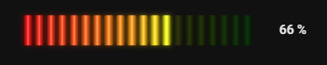

# LED Bar Card

A 20-segment LED meter card for Home Assistant dashboards. The segments run from red at the minimum, through orange, to green at the maximum, with a glowing "lit" look for active segments. It has a full visual editor, so no YAML is needed.



Ideal for battery state of charge, tank levels, humidity, signal strength, or any numeric sensor with a sensible range.

## Features

- 20 LED-style segments with a smooth red → orange → green gradient
- Optional reversed colours (green → red) for values where high is bad, such as temperature or load
- Configurable minimum and maximum values
- Optional icon, name and unit, with adjustable name size and alignment
- Visual editor in the dashboard card picker
- Tap the card to open the entity's more-info dialog
- Works with the sections dashboard grid

## Installation

### HACS (recommended)

1. Open **HACS** in Home Assistant.
2. Open the **⋮** menu (top right) and choose **Custom repositories**.
3. Add `https://github.com/YOUR_USERNAME/led-bar-card` with the type **Dashboard**.
4. Search for **LED Bar Card** in HACS and download it.
5. Hard-refresh your browser (Ctrl + F5, or Cmd + Shift + R on a Mac).

### Manual

1. Download `led-bar-card.js` from the [latest release](https://github.com/YOUR_USERNAME/led-bar-card/releases/latest).
2. Copy it to `/config/www/led-bar-card.js`.
3. Go to **Settings → Dashboards → ⋮ → Resources → Add resource** and enter:
   - URL: `/local/led-bar-card.js?v=1`
   - Resource type: **JavaScript module**
4. Hard-refresh your browser.

When you update the file manually, bump the `?v=` number so browsers load the new version.

## Usage

Edit a dashboard, choose **Add card**, and pick **LED Bar Card**. Everything can be set in the visual editor.

### Minimal YAML

```yaml
type: custom:led-bar-card
entity: sensor.battery_soc
```

### Full example

```yaml
type: custom:led-bar-card
entity: sensor.battery_soc
name: Battery
icon: mdi:battery
min_value: 0
max_value: 100
show_name: true
show_icon: true
show_unit: true
name_font_size: 14
name_position: mid
reverse_colours: false
```

### Compact bar, value only (as in the screenshot)

```yaml
type: custom:led-bar-card
entity: sensor.battery_soc
show_name: false
show_icon: false
grid_options:
  columns: 9
  rows: auto
```

## Options

| Option | Type | Default | Description |
| --- | --- | --- | --- |
| `entity` | string | **required** | A numeric sensor entity |
| `name` | string | Entity friendly name | Text shown under the bar |
| `icon` | string | Entity icon | Any `mdi:` icon |
| `unit` | string | Entity unit | Overrides the unit shown after the value |
| `min_value` | number | `0` | Value at which no segments are lit |
| `max_value` | number | `100` | Value at which all segments are lit |
| `show_name` | boolean | `true` | Show the name under the bar |
| `show_icon` | boolean | `true` | Show the icon to the left of the bar |
| `show_unit` | boolean | `true` | Show the unit after the value |
| `name_font_size` | number | `14` | Name text size in pixels (8–40) |
| `name_position` | string | `mid` | Name alignment: `left`, `mid` or `end` |
| `reverse_colours` | boolean | `false` | Green at the minimum, red at the maximum |

Values outside the min–max range are clamped, so the bar shows empty or full. Non-numeric states (such as `unavailable`) are shown as text with no segments lit.

## Licence

MIT, see [LICENSE](LICENSE).
